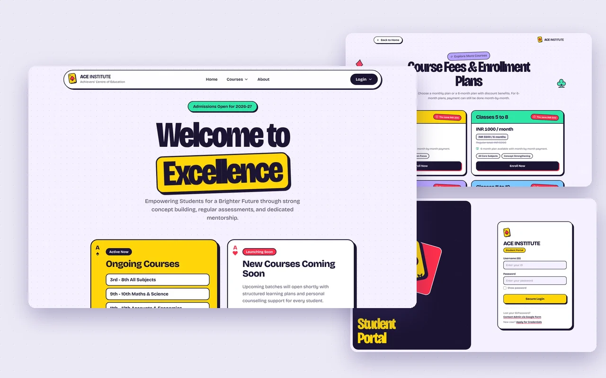
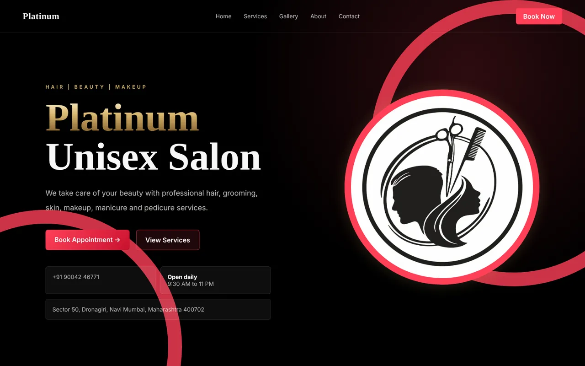

  

  
  
  

## Hi, I'm Rohit 👋

I build web apps that real people use every day, and I take them all the way to production.
I'm a final-year B.Tech IT student at **VIT Vellore** and a freelance full-stack developer.

- 🚀 Shipped **2 paid client systems** end to end: requirements, data model, API, UI and deployment
- 🧠 Co-inventor on **3 published Indian patent applications** in applied AI
- 🍃 Certified: [Building AI-Powered Search with MongoDB Vector Search](https://www.credly.com/badges/bf22f614-31f1-418c-8050-36155eab5717)
- 🎯 Open to **full-stack internships** and **freelance projects**

## Featured work

<table>
  <tr>
    <td width="50%" align="center">
      
       <b>ACE Academy</b> · <a href="https://achieverscentreofeducation.vercel.app/">live</a>
    </td>
    <td width="50%" align="center">
      
       <b>Platinum Unisex Salon</b> · <a href="https://platinumunisexsalon.vercel.app/">live</a>
    </td>
  </tr>
</table>

| Project | What it does | Built with | Links |
|---|---|---|---|
| **[ACE Academy](https://github.com/rohitpawalia28/ACE-Academy)** Paid client build · 2026 | Institute management system with separate dashboards for admins, teachers and students: attendance, timetables, marks, study material and progress, with live updates. Installable as an app from the browser. | React · Vite · Express · MongoDB · Socket.IO | [Live](https://achieverscentreofeducation.vercel.app/) · [Code](https://github.com/rohitpawalia28/ACE-Academy) |
| **[Platinum Unisex Salon](https://github.com/rohitpawalia28/Platinum-Unisex-Salon)** Paid client build · 2026 | Website for a working salon in Navi Mumbai. Customers book online and WhatsApp opens with their booking ready to send; the owner manages bookings and enquiries from a dashboard. | Next.js · TypeScript · Tailwind · MongoDB | [Live](https://platinumunisexsalon.vercel.app/) · [Code](https://github.com/rohitpawalia28/Platinum-Unisex-Salon) |
| **[CogniShield](https://github.com/rohitpawalia28/Cognishield)** AI security · 2026 | Protects a photo before you share it: adds a near-invisible perturbation that disrupts AI image-to-image models, tests it against JPEG compression, and signs the result so tampering can be detected. Runs fully offline. | Python · PyTorch · Flask · OpenCV | [Code](https://github.com/rohitpawalia28/Cognishield) |
| **[Urban Heat Island Prediction](https://github.com/rohitpawalia28/CloudBasedUrbanHeatIslandPrediction_Azure_Cloud_Project_2026)** Cloud + ML · 2026 | Predicts urban heat intensity for every 1 km cell of Delhi NCR (R² 0.96 on a spatial hold-out). The full AWS pipeline (S3, Lambda, Glue, SageMaker, Step Functions, API Gateway) runs on an emulated account on any laptop, or deploys to real AWS with CloudFormation. | Python · Flask · scikit-learn · AWS | [Code](https://github.com/rohitpawalia28/CloudBasedUrbanHeatIslandPrediction_Azure_Cloud_Project_2026) |
| **[Sentinel Entropy IDS](https://github.com/rohitpawalia28/entropy-zero-day-detection)** Network security · 2025 | Flags unusual traffic in packet captures without attack signatures, by tracking the Shannon entropy of IPs, ports and packet sizes against a learned baseline. | Python · Scapy · Pandas · Streamlit | [Code](https://github.com/rohitpawalia28/entropy-zero-day-detection) |
| **[Taxi Route Anomaly Detection](https://github.com/rohitpawalia28/taxi-route-anomaly-detection)** Big data · 2025 | Finds overcharged trips and abnormal routes across 32 GB of NYC taxi data, then suggests a cheaper nearby pickup point for any route. | PySpark · Pandas · Streamlit | [Code](https://github.com/rohitpawalia28/taxi-route-anomaly-detection) |

## Toolkit

| | |
|---|---|
| **Frontend** |  |
| **Backend** |  &nbsp;+ Socket.IO, REST APIs, JWT |
| **Data** |  &nbsp;+ PySpark, Pandas, MongoDB Vector Search |
| **Ship** |  &nbsp;+ Render |

## Research

Co-inventor on three published Indian patent applications:

- Time-aware retrieval-augmented predictive behavioral risk scoring in cognitive care settings
- Engagement-adaptive multimodal retrieval-augmented personalized reminiscence interaction
- Epsilon-bound-verified fuzzy-rule surrogate modeling for interpretable LLM compression

---

  Have something people need built? <a href="mailto:merohitk281205@gmail.com">Email me</a> or see more at <a href="https://rohitkumar.app">rohitkumar.app</a>.

